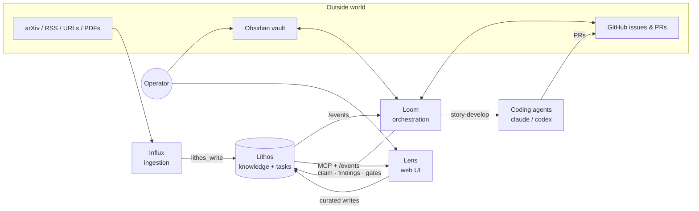

# How the ecosystem fits together

Lithos started as one server. The projects around it grew out of three recurring needs: getting knowledge *into* it without an agent in the loop, getting tasks *out of* it and into running coding agents, and seeing what is going on. Each is its own repository under [agent-lore](https://github.com/agent-lore), with its own version number and release cadence, and each talks to Lithos only through Lithos's public surfaces: the MCP tools, the `/events` stream, and the on-disk Markdown.

| Project | Role | Talks to Lithos via | Writes into Lithos |
|---------|------|---------------------|--------------------|
| **Lithos** | The knowledge base, task graph and MCP server everything else depends on | — | — |
| **[Influx](../influx/index.md)** | Scheduled ingestion of papers, feeds and submitted URLs/PDFs; LLM enrichment; archiving | `lithos_write`, `lithos_search`, `lithos_task_*` for the inbox | Knowledge notes (`ingested-by:influx`), inbox task outcomes |
| **[Loom](../loom/index.md)** | Turns Lithos tasks into executed work: route matching, collision-safe claiming, `story-develop` implement → review → PR, gates, Obsidian bridge, GitHub watcher | `/events` subscription, `lithos_task_*`, `lithos_finding_post`, `lithos_write` for project-context docs | Claims, findings, gates and follow-on tasks; mirrored GitHub issues; project-context notes |
| **[Lens](../lens/index.md)** | Live dashboard, dependency and knowledge graphs, finding timelines, knowledge search | MCP over `/sse`, `/events` subscription | Only the curated operator actions: create, cancel, reopen, dependency edges, gate completion |

## Where each kind of thing lives

- **Knowledge** is Markdown under Lithos's data path, with YAML frontmatter. Influx writes it, agents and Lens read it, the knowledge graph in Lens draws the typed edges Lithos infers or that notes declare.
- **Tasks, claims, findings and gates** are Lithos's coordination store. Loom and the coding agents move them through their lifecycle; Lens shows them; the Obsidian bridge projects them into a vault and pushes edits back.
- **Project context** for a Loom project is a Lithos note that Loom keeps in sync with a doc in the Obsidian vault and that carries the GitHub watcher configuration.
- **Code and PRs** never pass through Lithos. Loom runs agents in git worktrees on the host, delivers PRs to GitHub, and records the outcome as findings and `pr` gates on the task.

## Running the whole thing

A typical single-host install runs Lithos and Influx under Docker Compose (each repo ships its own stack), Loom as a host process (it needs the `claude`/`codex`/`gh` CLIs and git worktrees), and Lens under Docker next to Lithos. Observability for all four goes through one OTLP collector; see [Lithos observability](../deployment/observability.md) for the collector side and each project's pages for what it emits.

Start with Lithos. Add Lens next, because it makes everything else visible. Add Influx when you want knowledge arriving without you, and Loom when you have tasks you want agents to pick up on their own.
