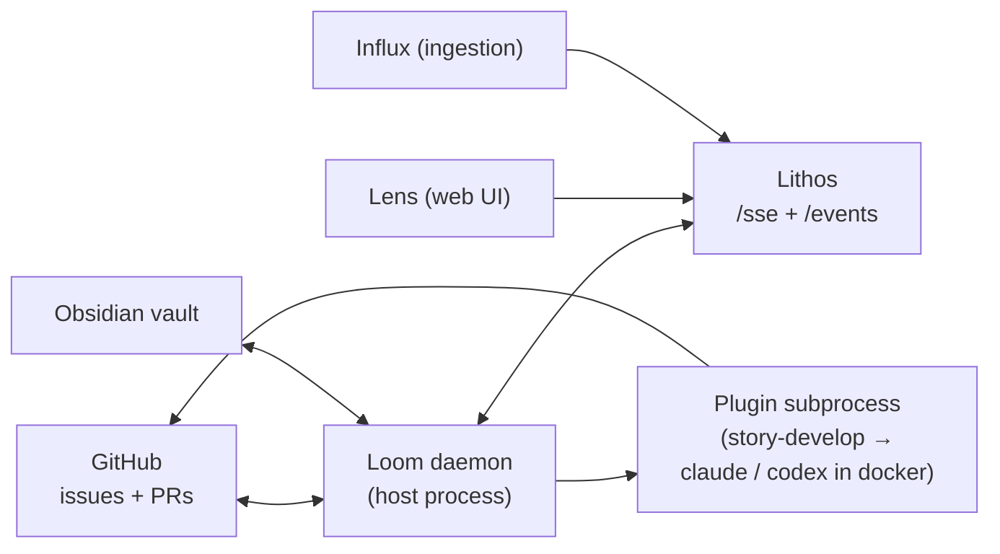

# Loom

Loom (`lithos-loom`) is the orchestration daemon of the Lithos ecosystem. It subscribes to Lithos's event stream, claims Lithos tasks by tag, and hands them to subprocess plugins — the shipped one, `story-develop`, runs an implement → review → PR loop with containerised coding agents. It also projects Lithos tasks into an Obsidian vault and mirrors GitHub issues into Lithos tasks.

!!! warning "Status: pre-release, under active development, documents `main`"
    Loom has no tagged release yet (package version 0.1.0) and its CLI, config and plugin surfaces still change week to week. These pages describe the current `main` branch of [agent-lore/lithos-loom](https://github.com/agent-lore/lithos-loom); the per-command CLI pages are pulled from that repo at build time so they cannot lag it.

**Source repo:** [github.com/agent-lore/lithos-loom](https://github.com/agent-lore/lithos-loom) (MIT).

---

## Three surfaces

One `lithos-loom run` process is a supervisor that forks up to three children, each gated by a block in the TOML config:

| Surface | Child | Spawn gate | What it does |
|---------|-------|------------|--------------|
| **Route-runner** | `route-runner` | any `[[routes]]` stanza | Consumes `lithos.task.created` / `updated` / `released` events, matches task tags against routes, asks Lithos whether the task is ready, claims it collision-safely, runs the route's plugin as a subprocess and applies `result.json`. Adding a route's trigger tag to an already-open task dispatches it without a restart. |
| **Obsidian bridge** | `obsidian-sync` | `[obsidian_sync]` present | Projects open tasks into a Tasks-plugin-compatible `_lithos/tasks.md`, pushes tick / priority / due-date edits back to Lithos, mirrors project-context docs both ways, and ships Templater macros for capture. |
| **GitHub issue watcher** | `github-watcher` | `[github_watcher] enabled = true` | Polls each watched repo, materialises new issues as Lithos tasks carrying `metadata.github_issue_url`, mirrors title / body / labels / close in both directions, and resolves the `pr` gates that delivered PRs leave behind. |

Each child runs its own in-process event bus and its own connection to Lithos; there is no inter-child IPC. Restart safety comes from sources re-bootstrapping on connect and subscribers being idempotent — Loom keeps no persistent event log.

---

## How it fits the ecosystem

- **Lithos** owns the corpus and the task lifecycle. Loom never replaces it as the source of truth — the vault is a projection plus a narrow write surface, and every orchestration state Loom needs to survive a restart lives on the Lithos task (metadata keys, findings, gate tasks and `waits_on_gate` edges).
- **Loom** is the only piece that runs coding agents. A `story-develop` run ends with a reviewed branch and an open PR; the task stays open behind a first-class `pr` gate until the PR merges, when the watcher completes the story.
- **Lens** reads the same gates, findings and `reconciliation_state` keys Loom writes; **Influx** feeds the knowledge base Loom's agents search.

Loom deliberately runs as a **host process, not a container**: it creates git worktrees you can `cd` into, invokes `claude` / `codex` / `gh` CLIs that authenticate against per-user dotfiles, and must be on Obsidian Desktop's PATH for the Templater macros.

---

## What Loom needs from Lithos

Loom talks MCP to Lithos over the `/sse` endpoint and consumes `GET /events` for `task.*` and `note.*` events. Beyond the ordinary task and knowledge tools it depends on:

| Lithos feature | Used for |
|----------------|----------|
| `task.metadata` + single-shot `lithos_task_create(metadata=...)` | Every `metadata.*` key Loom reads or writes (project, priority, `develop_*`, `github_issue_url`, markers) |
| Task graph: `task_type`, `blocks` / `parent_child` / `waits_on_gate` edges, `lithos_task_ready` / `lithos_task_blocked` / `lithos_task_spawn` | Server-side readiness (the runner never derives it itself), `project import` task graphs, `pr` and `human` gates. **The daemon refuses to boot** if the probe fails. |
| `lithos_write(id=..., expected_version=...)` with the `version_conflict` envelope | Vault → Lithos note push with optimistic locking |
| `lithos_task_complete` returning the tasks it unblocked | Dispatching the next task in a chain off the completion itself |
| `lithos_finding_post` | Prefixed findings (`[Friction]`, `[NeedsHuman]`, …) — the operator-facing audit trail |

Run `lithos-loom doctor` to probe all of this end to end against a live server.

---

## Pages

| Page | What it covers |
|------|----------------|
| [Installation](installation.md) | Requirements, `uv` install, config discovery, running and draining the daemon, `doctor` |
| [Concepts](concepts.md) | Routes and tag matching, readiness and claiming, the plugin contract and `result.json`, gates, the event bus, finding prefixes |
| [story-develop](story-develop.md) | The implement → review → PR loop, review profiles and personas, model resolution, converge, merge gate, review-only mode, admission |
| [Obsidian bridge](obsidian-bridge.md) | Projects, the task inbox projection, bidirectional sync, Templater macros |
| [GitHub watcher](github-watcher.md) | Issue mirroring in both directions, per-project repos, the per-host gate, reopen handling, PR-gate resolution |
| [CLI](cli.md) | Every command group at a glance, with links to the per-command reference pages |
| [Changelog](changelog.md) | Current state of `main` (no tagged releases yet) |
